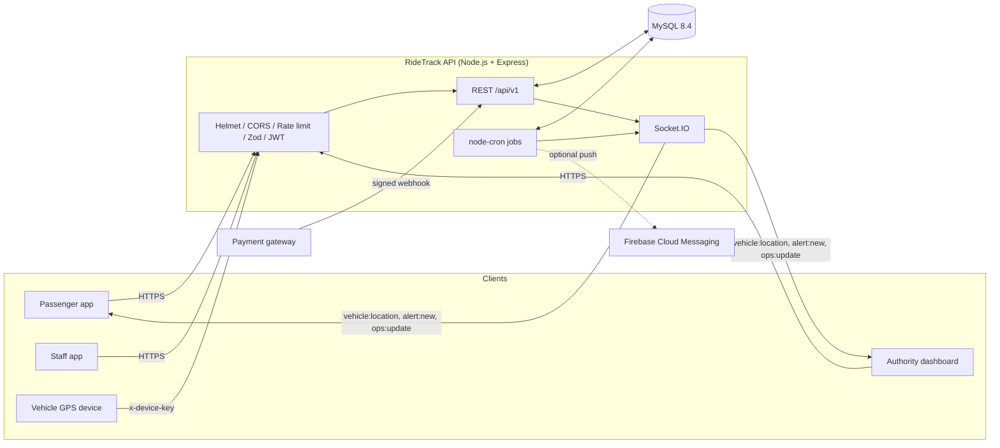
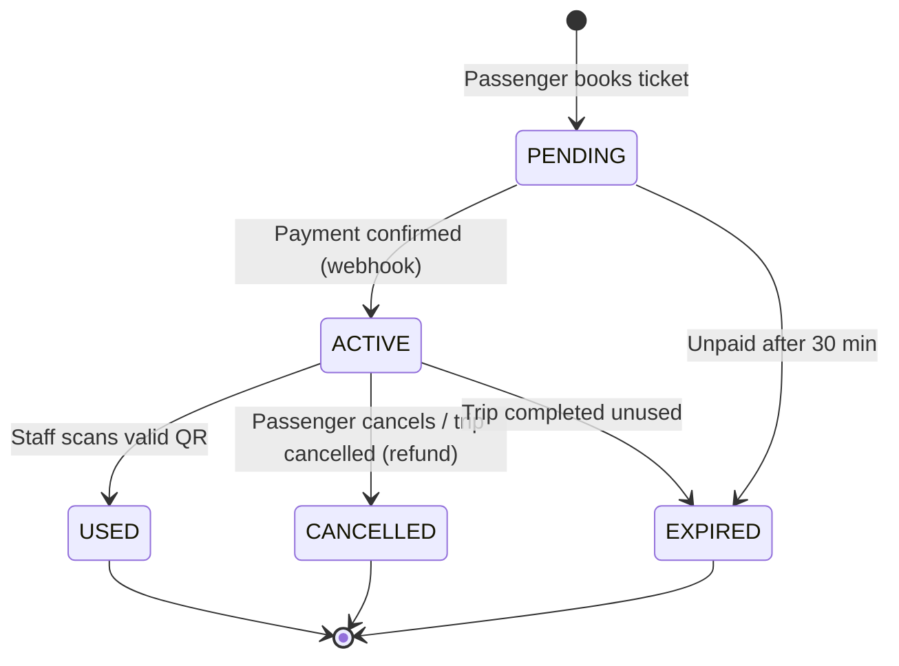
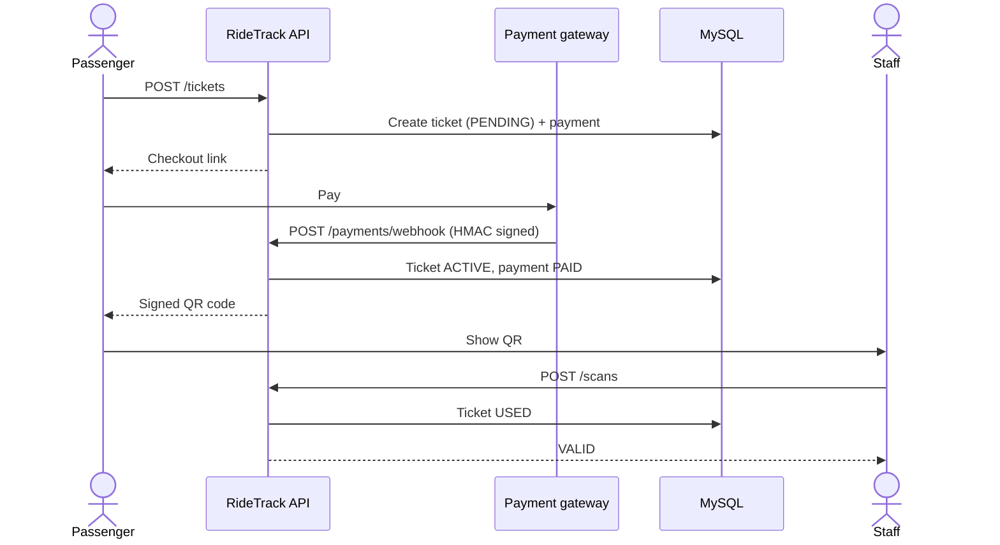
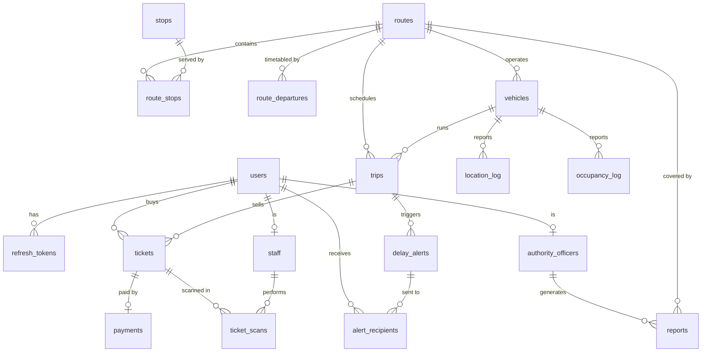

<div align="center">

# 🚍 RideTrack API

**Real-time public transport backend for buses and trains.**<br>
Live tracking · QR ticketing · Payments · Delay alerts


[](https://github.com/sithira-janiya/Ride-Track-Backend/commits/main)
[](https://github.com/sithira-janiya/Ride-Track-Backend)
[](https://github.com/sithira-janiya/Ride-Track-Backend/issues)
[](https://github.com/sithira-janiya/Ride-Track-Backend)


[**Quick start**](#-quick-start) · [**Architecture**](#-architecture) · [**API**](#-api-reference) · [**Real-time**](#-real-time-events) · [**Testing**](#-testing)

</div>

---

## 📊 At a glance

<!-- STATS:START -->
<table>
  <tr>
    <td align="center"><h2>49</h2>REST endpoints</td>
    <td align="center"><h2>19</h2>DB tables</td>
    <td align="center"><h2>10</h2>API modules</td>
    <td align="center"><h2>96</h2>automated tests</td>
    <td align="center"><h2>5</h2>background jobs</td>
    <td align="center"><h2>13</h2>runtime deps</td>
  </tr>
</table>
<sub>Generated by <code>npm run readme</code> from the source on 2026-10-14.</sub>
<!-- STATS:END -->

## 🧭 Overview

RideTrack is the REST + WebSocket backend for a public transport app, built around three app roles and an admin:

<table>
  <tr>
    <td width="25%" valign="top"><h3>🧑 Passenger</h3>Browse routes and stops, follow vehicles live, buy tickets, get delay alerts.</td>
    <td width="25%" valign="top"><h3>🎟️ Staff</h3>Scan and validate QR tickets, report vehicle occupancy.</td>
    <td width="25%" valign="top"><h3>🛠️ Authority</h3>Manage routes and trips, watch the live dashboard, publish alerts, run reports.</td>
    <td width="25%" valign="top"><h3>🔐 Admin</h3>Create staff, officer and admin accounts; disable and re-enable accounts; everything officers can do in the admin panel.</td>
  </tr>
</table>

GPS devices on vehicles authenticate separately with a shared device key.

## ✨ Features

- 🔐 **JWT auth** with short-lived access tokens, rotating refresh tokens and role-based access control (`PASSENGER`, `STAFF`, `AUTHORITY`, `ADMIN`)
- 🔑 **Separate admin sign-in** with a tighter rate limit, 12-hour sessions, 12+ character passwords and an account check on every admin request
- 🌍 **Four regions**: Sri Lanka (demo routes, LKR) and real open timetable data for **Dubai** (Metro, tram and buses, RTA fare zones), **Hong Kong** (tram, Peak Tram and buses incl. airport route A21, real section fares) and **Kuala Lumpur** (every Rapid KL rail line and the Sunway BRT), each on its own clock and currency
- 🧭 **GTFS importer**: `scripts/import-gtfs.js` turns a city's GTFS feed (trip-based or frequency-based) into a region, configured per city in `scripts/gtfs-cities.js`
- 🕒 **Timetables**: departures per weekday in each region's own time zone, turned into trips by the seed and an hourly job
- 📍 **Live tracking**: GPS ingestion, per-route Socket.IO rooms, live ETA vs. timetable
- 🎫 **QR ticketing**: signed QR payloads, staff validation, manual-ID fallback, cancellation
- 💳 **Payments**: pluggable gateway, HMAC-signed webhooks, mock checkout for development
- ⏱️ **Automatic delay detection**: raises an alert when a trip runs 10+ minutes behind
- 🔔 **Alerts** over WebSocket and optional Firebase push notifications
- 📊 **Ops dashboard and reports** for authority officers
- 🖥️ **Admin panel** at `/admin`: a built-in web back office for users, routes, vehicles, trips, tickets, alerts and reports
- 🛡️ **Hardened by default**: Helmet, CORS, rate limiting, Zod request validation, constant-time key comparison
- 🗄️ **MySQL or Microsoft SQL Server** (including Azure SQL), chosen with `DB_CLIENT`
- 🧪 **Integration tests** against a real MySQL or SQL Server test database

## 🏗️ Architecture



### Ticket lifecycle



### Buying a ticket



### Data model



## 🧰 Tech stack

| Layer | Technology |
| --- | --- |
| Runtime | Node.js 20+ (ES modules) |
| Web framework | Express 4, Helmet, CORS, express-rate-limit |
| Real-time | Socket.IO 4 |
| Database | MySQL 8.4 via `mysql2`, or SQL Server 2017+ / Azure SQL via `mssql` |
| Validation | Zod |
| Auth | `jsonwebtoken`, `bcryptjs` |
| Scheduling | `node-cron` |
| Testing | Jest, Supertest, socket.io-client |
| Packaging | Docker, Docker Compose |

## 🚀 Quick start

### Prerequisites

- Node.js 20 or newer
- Docker (for MySQL), or your own MySQL 8 instance

```bash
# 1. Install dependencies
npm install

# 2. Configure the environment
cp .env.example .env

# 3. Start MySQL (exposed on port 3307)
docker compose up -d db

# 4. Create the schema and load demo data
npm run migrate
npm run seed

# 5. Run the API with auto-reload
npm run dev
```

The API is now at `http://localhost:3000`. Check it with `GET /health`.

### Run everything in Docker

```bash
docker compose up -d --build
```

This starts MySQL and the API together. The compose file uses throwaway development secrets; set your own for any real deployment.

### Demo accounts

`npm run seed` creates one user per role. All use the demo password from `scripts/seed.js`.

| Role | Email |
| --- | --- |
| 🧑 Passenger | `passenger@ridetrack.test` |
| 🎟️ Staff | `staff@ridetrack.test` |
| 🛠️ Authority | `officer@ridetrack.test` |
| 🔐 Admin | `admin@ridetrack.test` (signs in at `/admin/auth/login`; not seeded when `NODE_ENV=production`) |

> Demo data only. Never seed these accounts into a real deployment.

### Admin panel

Open [http://localhost:3000/admin](http://localhost:3000/admin) and sign in with an admin account (e.g. `admin@ridetrack.test`) or an authority account (e.g. `officer@ridetrack.test`). Admins and officers can:

- see live vehicles, delays, today's trips and sales at a glance
- create and edit routes and stops, add or retire vehicles, schedule trips and change their status
- browse tickets and payments, publish delay/cancellation alerts and run reports

Admins also get the **Users** page: search accounts, create staff, officer and admin accounts, assign conductors to vehicles, and disable accounts (which also signs them out). Officers do not see it.

The panel is plain HTML/JS served by the API itself (`src/admin/`), so there is nothing extra to build or deploy.

### Simulate live vehicles

```bash
npm run simulate
```

Drives the vehicles of every running trip along their routes so you can watch live positions, ETAs and delay alerts without real hardware. Vehicles keep to the timetabled time between stops. At peak the four regions have about 260 vehicles on the road, so positions go out in parallel batches, and `location_log` grows by roughly one row per vehicle per tick while it runs (`SIM_INTERVAL_MS`, default 3000, slows it down).

### Regions

Every route has a `region` (see `src/config/regions.js`, or `GET /regions`). It sets the time zone the route's timetable runs on, the currency of its fares and how a fare is worked out (`fareModel`). Route and ticket responses carry `region`, `timeZone`, `currency` and `fareModel`, so the app shows each route's times on its local clock.

| Region | Clock | Currency | Fare model | Routes |
| --- | --- | --- | --- | --- |
| `SRI_LANKA` | Asia/Colombo | LKR | `STOP_DIFFERENCE`: the difference of the stops' `fareFromOrigin` | 3 demo routes |
| `DUBAI` | Asia/Dubai | AED | `ZONE`: by the number of fare zones touched (`zoneFares`) | 16 (RTA GTFS) |
| `HONG_KONG` | Asia/Hong_Kong | HKD | `BOARDING`: the fare of the stop you board at, held in its `fareFromOrigin` | 12 (Transport Department GTFS) |
| `KUALA_LUMPUR` | Asia/Kuala_Lumpur | MYR | `DISTANCE`: `distanceFare.base` + `perKm` along the route, capped at `max` (an estimate) | 16 (Prasarana GTFS) |

- **Sri Lanka**: three demo routes (Colombo buses 138 and 177, the Main Line to Kandy). Fares are by stop. The timetable is a demo one (a vehicle every 1 to 3 hours, all day), made by the seed for any route without a timetable.
- **Dubai**: real data from Dubai RTA's GTFS feed: Metro Red Line (both branches, to Expo 2020 and to Life Pharmacy), Metro Green Line, the Dubai Tram and buses C01, 27, 8 and X28, each direction as its own route (16 routes, 257 stops). Each route has the real stop order, the RTA fare zone of every stop, the median timetabled running time between stops, and the departure times for each day of the week. Fares follow RTA's Nol Silver zone prices: AED 3 within one zone, AED 5 across two, AED 7.50 for three or more (`zoneFares` in the region config). Vehicles are named per route (e.g. `DXB-MRED1A-03`); each route gets enough of them to run its busiest day.

The Dubai data lives in `db/data/dubai-rta.json` (60 KB), so seeding needs no download. To refresh it from a newer feed:

1. Download the feed: [Mobility Database mdb-3359](https://mobilitydatabase.org/feeds/mdb-3359) (a mirror of RTA's `rta_gtfs-open` dataset on [Dubai Pulse](https://www.dubaipulse.gov.ae/organisation/rta/service/rta-public-transports), which needs a permission request), and unzip it (about 270 MB).
2. Run `node scripts/import-dubai-gtfs.js <unzipped folder> --out db/data/dubai-rta.json --out ../Ride-Track-Frontend/src/api/mock-data/dubai-rta.json` (the second file is the app's mock-mode copy).
3. `npm run seed:reset` (or, on an existing database, remove the Dubai routes first: `npm run seed` only adds a region that has no routes yet).

Limits of the Dubai data: RTA publishes no open live GPS feed, so Dubai vehicles move only when `npm run simulate` (or a real device) sends positions; until then arrivals are timetable times. The feed used is valid from 29 Aug to 31 Dec 2025; its weekly pattern (Monday to Thursday, Friday, Saturday, Sunday) is applied to every week, so service changes and public holidays after that are not reflected. Short workings (trips that start or end part-way along a line) are left out, and running times are the median for the line, not per trip.

#### Hong Kong and Kuala Lumpur

- **Hong Kong**: from the Transport Department's GTFS feed on [DATA.GOV.HK](https://data.gov.hk/en-data/dataset/hk-td-tis_11-pt-headway-en): the Hong Kong Tramways line (Shau Kei Wan to Kennedy Town), the Peak Tram, Citybus A21 (Hung Hom to the airport), KMB 1A and 6 and Citybus 6, each direction as its own route (12 routes). Fares are the feed's section fares: what you pay depends on where you board (A21 from the airport is HKD 34.60, HKD 8.40 once in Kowloon). In 37 of 347 boarding stops the feed's fare also varies by destination; RideTrack uses the fare to the end of the route there. The feed has no MTR rail, and times only its first and last stop, so stops in between are timed by distance.
- **Kuala Lumpur**: from Prasarana's Rapid Rail feed on [data.gov.my](https://developer.data.gov.my/realtime-api/gtfs-static): the Ampang, Sri Petaling, Kelana Jaya and Shah Alam LRT lines, the Kajang and Putrajaya MRT lines, the KL Monorail and the Sunway BRT (16 routes, 162 stations). The feed gives frequencies ("every 3 minutes"), which become departure times. It has no fares, so fares are **estimated** by distance (MYR 1.20 + 0.15 per km, at most 6.40) until Prasarana's fare table is added. Rapid KL buses are not included yet.

To add or refresh a city, download and unzip its GTFS feed, then run `node scripts/import-gtfs.js <unzipped folder> --city hong-kong` (or `kuala-lumpur`). It writes `db/data/<city>.json`; then `npm run seed:reset`. A new city needs an entry in `scripts/gtfs-cities.js` (which routes to take and how to name stops), a region in `src/config/regions.js` and a line in `GTFS_REGIONS` in `scripts/seed.js`. Neither feed is live GPS, so vehicles move only when `npm run simulate` (or a real device) sends positions.

## ⚙️ Configuration

Copy `.env.example` to `.env`. Key variables:

| Variable | Purpose |
| --- | --- |
| `PORT`, `PUBLIC_URL` | Listen port and the public URL used to build payment links |
| `CORS_ORIGIN` | `*` or a comma-separated list of allowed origins |
| `DB_CLIENT` | `mysql` (default) or `mssql` for Microsoft SQL Server / Azure SQL |
| `DB_HOST`, `DB_PORT`, `DB_USER`, `DB_PASSWORD`, `DB_NAME`, `DB_SSL` | Database connection (`DB_SSL=true` turns on TLS / `Encrypt` for SQL Server) |
| `DB_INSTANCE` | SQL Server named instance, e.g. `SQLEXPRESS` (then `DB_PORT` is not used) |
| `DB_TRUSTED_CONNECTION` | `true` signs in to SQL Server with the Windows account running the API (Windows only, see below) |
| `DB_TRUST_SERVER_CERTIFICATE` | SQL Server: accept a self-signed certificate (default `true` outside production) |
| `JWT_ACCESS_SECRET`, `JWT_ACCESS_TTL`, `JWT_REFRESH_TTL_DAYS` | Token signing and lifetimes |
| `ADMIN_REFRESH_TTL_HOURS` | Admin session length (default 12) |
| `QR_SIGNING_SECRET` | Signs ticket QR payloads |
| `PAYMENT_GATEWAY`, `PAYMENT_GATEWAY_KEY` | Gateway selection and webhook signing key (`mock` for development) |
| `DEVICE_API_KEY` | Shared key GPS devices send as `x-device-key` |
| `FCM_SERVICE_ACCOUNT` | Optional Firebase service-account JSON for push notifications |
| `GOOGLE_TRANSLATE_API_KEY` | Optional Google Cloud Translation key: alerts reach each passenger in their language (`en`, `si`, `ta`) |
| `RESEND_API_KEY`, `MAIL_FROM` | Optional [Resend](https://resend.com) key and sender for password reset emails; without a key, codes are printed to the log in development |
| `ENABLE_JOBS` | Toggle background jobs |

Use long random values for every secret in production. `DB_POOL_SIZE` (default 20) sets the database connection pool size.

### Using Microsoft SQL Server

The same code runs on SQL Server 2017 or newer and on Azure SQL. Set `DB_CLIENT=mssql`; `npm run migrate` then applies
`db/schema.mssql.sql` and creates the database first if the login is allowed to.

```bash
# SQL Server in Docker (port 1434 on your machine)
docker compose --profile mssql up -d mssql
```

```env
DB_CLIENT=mssql
DB_HOST=localhost
DB_PORT=1434
DB_USER=sa
DB_PASSWORD=RideTrack_dev1
DB_NAME=ridetrack
```

For a local SQL Server Express that only allows Windows sign-in (the default install), use the named instance and
Windows authentication. This uses the optional `msnodesqlv8` package and the "ODBC Driver 18 for SQL Server", which
`npm install` adds on Windows (`DB_ODBC_DRIVER` picks another installed driver):

```env
DB_CLIENT=mssql
DB_HOST=localhost
DB_INSTANCE=SQLEXPRESS
DB_TRUSTED_CONNECTION=true
DB_NAME=ridetrack
```

For Azure SQL, create the database in the portal first, then set `DB_HOST=<server>.database.windows.net`, `DB_SSL=true`
and `DB_TRUST_SERVER_CERTIFICATE=false`.

## ☁️ Deployment

The `Dockerfile` applies the schema (`node scripts/migrate.js`, which is safe to re-run and adds any missing columns and indexes) and then starts the API, so any container host works. These steps use [Railway](https://railway.com):

1. Create a project with **Deploy from GitHub repo** and pick this repository. Railway builds the `Dockerfile` and reads `railway.json` (health check on `/health`, one replica, restart on failure).
2. In the same project, add **New → Database → MySQL**.
3. On the API service's **Variables** tab, set:

   ```text
   NODE_ENV=production
   DB_HOST=${{MySQL.MYSQLHOST}}
   DB_PORT=${{MySQL.MYSQLPORT}}
   DB_USER=${{MySQL.MYSQLUSER}}
   DB_PASSWORD=${{MySQL.MYSQLPASSWORD}}
   DB_NAME=${{MySQL.MYSQLDATABASE}}
   JWT_ACCESS_SECRET=<random>
   QR_SIGNING_SECRET=<random>
   PAYMENT_GATEWAY_KEY=<random>
   DEVICE_API_KEY=<random>
   CORS_ORIGIN=<your front-end origin(s), comma-separated>
   ALLOW_MOCK_PAYMENTS=true
   ```

   Do not set `PORT`: Railway provides it. `PUBLIC_URL` defaults to the service's Railway domain, so set it only for a custom domain. `ALLOW_MOCK_PAYMENTS=true` is required for now: `mock` is the only gateway implemented, and without it the API refuses to start in production.

   Generate each random value with `node -e "console.log(require('crypto').randomBytes(48).toString('base64url'))"`.
4. Under **Settings → Networking**, generate a domain and redeploy (so `RAILWAY_PUBLIC_DOMAIN` is set).
5. Check `https://<your-domain>/health`: it should return `{"status":"ok"}`.
6. Create the first admin: open a shell with `railway ssh` and run `node scripts/create-admin.js --email you@example.com`. It prints a generated password once (or uses `ADMIN_PASSWORD` if set). Running it again for the same email resets the password and signs that admin out everywhere. Further admins can be added from `POST /admin/users`.

Notes:

- In production the app refuses to start with `PAYMENT_GATEWAY=mock` unless `ALLOW_MOCK_PAYMENTS=true`. That is acceptable for a demo; real payments need a real gateway.
- Run a **single instance**: the latest vehicle positions and Socket.IO rooms live in memory.
- For demo data, open a shell in the running service with `railway ssh` and run `ALLOW_DEMO_SEED=true node scripts/seed.js` (demo accounts only, never on a real deployment). `railway run` does not work for this: it runs on your machine, which cannot reach the private `mysql.railway.internal` host. Running it again on an existing demo database adds the Dubai routes and timetables without touching the Sri Lanka data or accounts. After that the `extendTimetable` job keeps trips coming, so the seed does not need re-running every 12 hours.

## 📡 API reference

Base URL: `/api/v1`. Send `Authorization: Bearer <accessToken>` unless noted. Browsing endpoints (routes, stops, arrivals) are public. Roles are enforced server-side.

<details open>
<summary><b>Auth and users</b></summary>

| Method | Endpoint | Access | Description |
| --- | --- | --- | --- |
| `POST` | `/auth/register` | 🌐 Public | Create an account |
| `POST` | `/auth/login` | 🌐 Public | Obtain access and refresh tokens |
| `POST` | `/auth/refresh` | 🌐 Public | Rotate the refresh token |
| `POST` | `/auth/forgot-password` | 🌐 Public | Send a 6-digit reset code to the account's email (or phone) |
| `POST` | `/auth/reset-password` | 🌐 Public | Set a new password with the code; signs out other sessions and returns new tokens |
| `GET` | `/users/me` | 🔑 Any user | Current profile |
| `PATCH` | `/users/me` | 🔑 Any user | Update profile |
| `PUT` | `/users/me/push-token` | 🔑 Any user | Register a push token |

</details>


<details open>
<summary><b>Admin</b></summary>

Admins cannot use `/auth/login`, `/auth/refresh`, Google sign-in or the password reset, and app accounts cannot use the admin sign-in. Create the first admin with `npm run create-admin -- --email you@example.com`; running it again resets that admin's password. The other `/admin` endpoints back the admin panel.

| Method | Endpoint | Access | Description |
| --- | --- | --- | --- |
| `POST` | `/admin/auth/login` | 🌐 Public | Admin sign-in with `{ email, password }` |
| `POST` | `/admin/auth/refresh` | 🌐 Public | Rotate an admin refresh token |
| `POST` | `/admin/auth/logout` | 🌐 Public | Revoke an admin refresh token |
| `GET` | `/admin/overview` | 🔐 Admin, 🛠️ Authority | Headline counts: users, fleet, today's trips and sales |
| `GET` | `/admin/users` | 🔐 Admin | List accounts (`role`, `q`, `page`, `limit`), returns `{ total, users }` |
| `POST` | `/admin/users` | 🔐 Admin | Create a `STAFF`, `AUTHORITY` or `ADMIN` account |
| `PATCH` | `/admin/users/:id` | 🔐 Admin | Disable (ends its sessions) or re-enable an account, or assign a staff member's vehicle |
| `GET` | `/admin/routes` | 🔐 Admin, 🛠️ Authority | All routes, including inactive ones |
| `GET` | `/admin/vehicles` | 🔐 Admin, 🛠️ Authority | All vehicles |
| `POST` | `/admin/vehicles` | 🔐 Admin, 🛠️ Authority | Add a vehicle |
| `PATCH` | `/admin/vehicles/:id` | 🔐 Admin, 🛠️ Authority | Edit or retire a vehicle |
| `GET` | `/admin/trips` | 🔐 Admin, 🛠️ Authority | Trips on a given day |
| `GET` | `/admin/tickets` | 🔐 Admin, 🛠️ Authority | Tickets with payment status |

</details>


<details open>
<summary><b>Routes, stops and trips</b></summary>

| Method | Endpoint | Access | Description |
| --- | --- | --- | --- |
| `GET` | `/regions` | 🌐 Public | Regions with their time zone, currency and fare model |
| `GET` | `/routes` | 🌐 Public | List routes (`q`, `mode`, `region` = `SRI_LANKA`, `DUBAI`, `HONG_KONG` or `KUALA_LUMPUR`) |
| `GET` | `/routes/:id` | 🌐 Public | Route details |
| `GET` | `/routes/:id/arrivals` | 🌐 Public | Upcoming arrivals |
| `GET` | `/routes/:id/vehicles` | 🌐 Public | Live vehicles on the route |
| `POST` / `PATCH` | `/routes`, `/routes/:id` | 🛠️ Authority, 🔐 Admin | Create or update routes |
| `POST` | `/routes/:id/stops` | 🛠️ Authority, 🔐 Admin | Add a stop to a route |
| `GET` | `/stops/nearby` | 🌐 Public | Stops near a coordinate |
| `POST` / `PATCH` | `/trips`, `/trips/:id` | 🛠️ Authority, 🔐 Admin | Schedule or update trips |

</details>


<details open>
<summary><b>Tickets, payments and scans</b></summary>

| Method | Endpoint | Access | Description |
| --- | --- | --- | --- |
| `POST` | `/tickets` | 🧑 Passenger | Book a ticket |
| `GET` | `/tickets`, `/tickets/:id` | 🧑 Passenger | List or view own tickets |
| `POST` | `/tickets/:id/cancel` | 🧑 Passenger | Cancel a ticket |
| `POST` | `/payments/webhook` | Gateway (`x-signature`) | HMAC-SHA256 signed payment callback |
| `GET` / `POST` | `/payments/mock/*` | Mock gateway only | Development checkout page |
| `POST` | `/scans` | 🎟️ Staff | Validate a ticket QR |
| `GET` | `/trips/:id/scans` | 🎟️ Staff, 🛠️ Authority | Scans for a trip |

</details>


<details open>
<summary><b>Vehicles, alerts and operations</b></summary>

| Method | Endpoint | Access | Description |
| --- | --- | --- | --- |
| `POST` | `/vehicles/:id/location` | Device key | Submit a GPS position |
| `POST` | `/vehicles/:id/occupancy` | 🎟️ Staff | Report occupancy |
| `GET` | `/alerts` | 🧑 Passenger, 🛠️ Authority, 🔐 Admin | List alerts |
| `PATCH` | `/alerts/:id/read` | 🧑 Passenger | Mark an alert read |
| `POST` | `/alerts` | 🛠️ Authority, 🔐 Admin | Publish an alert |
| `GET` | `/ops/dashboard` | 🛠️ Authority, 🔐 Admin | Live operations summary |
| `GET` | `/reports` | 🛠️ Authority, 🔐 Admin | Route, delay and occupancy reports (an officer's runs are logged in `reports`) |
| `GET` | `/health` | 🌐 Public | Liveness and database check |

</details>

## ⚡ Real-time events

Connect with a valid access token. Subscribe to a route, then listen for live updates:

```js
const socket = io(API_URL, { auth: { token: accessToken } });
socket.emit('route:subscribe', { routeId: 1 });
socket.on('vehicle:location', (pos) => console.log(pos));
```

 Every user joins a private `user:<id>` room; authority users also join `ops`.

| Direction | Event | Payload |
| --- | --- | --- |
| Client → Server | `route:subscribe` / `route:unsubscribe` | `{ routeId }` |
| Server → Client | `vehicle:location` | Live position for a subscribed route |
| Server → Client | `vehicle:occupancy` | Occupancy update for a subscribed route |
| Server → Client | `alert:new` | Personal alert (delay, cancellation, route change) |
| Server → Client | `ops:update` | Change notification for the ops dashboard |

## ⏰ Background jobs

| Schedule | Job | Purpose |
| --- | --- | --- |
| Every minute | `advanceTrips` | Moves trips `SCHEDULED → ONGOING → COMPLETED` by the clock |
| Every minute | `expireTickets` | Expires unpaid tickets (30 min), refunds and cancels tickets on cancelled trips |
| Every 2 minutes | `detectDelays` | Compares live ETA with the timetable and raises a `DELAY` alert at 10+ minutes late |
| Hourly at :07, and on start | `extendTimetable` | Turns the next 12 hours of every route's timetable (`route_departures`) into trips, in the route's own time zone; trips that already exist are skipped |
| Daily 03:30 | `purgeOldLocations` | Prunes old GPS history |

## 🗂️ Project structure

```text
├── db/schema.sql            # MySQL schema
├── db/schema.mssql.sql      # the same schema for SQL Server / Azure SQL
├── db/data/                 # GTFS-derived routes, stops and timetables: dubai-rta.json, hong-kong.json, kuala-lumpur.json
├── docker/                  # DB init scripts (test database)
├── scripts/                 # migrate, seed, simulate, create-admin, import-gtfs (+ gtfs-cities), import-dubai-gtfs
├── src/
│   ├── app.js               # Express app and route wiring
│   ├── admin/               # admin panel (static HTML/JS/CSS, served at /admin)
│   ├── server.js            # HTTP + Socket.IO bootstrap
│   ├── config/              # env, DB pool, regions (time zone, currency, zone fares)
│   ├── middleware/          # auth, validation, error handling
│   ├── modules/             # auth, users, routes, vehicles, tickets,
│   │                        # payments, scans, alerts, ops, admin
│   ├── realtime/            # Socket.IO rooms and emitters
│   ├── jobs/                # cron jobs
│   └── utils/               # ETA, geo, errors, async helpers
└── tests/                   # Jest integration and unit tests
```

## 🧪 Testing

Tests run against a real MySQL test database, created by `docker/init-test-db.sql` when the `db` container first starts.

```bash
docker compose up -d db
npm test
```

The same suite runs against SQL Server. `TEST_DB_*` variables point it at a server; it uses a `ridetrack_test` database
and creates it if needed:

```bash
# SQL Server in Docker
TEST_DB_CLIENT=mssql TEST_DB_PORT=1434 TEST_DB_USER=sa TEST_DB_PASSWORD=RideTrack_dev1 npm test
# local SQL Server Express with Windows sign-in
TEST_DB_CLIENT=mssql TEST_DB_INSTANCE=SQLEXPRESS TEST_DB_TRUSTED_CONNECTION=true npm test
```

## 🔒 Security notes

- Secrets are read from environment variables; `.env` is git-ignored.
- Payment webhooks are verified with HMAC-SHA256 over the raw request body.
- Device and signature comparisons are constant-time.
- Request bodies are capped at 100 KB and validated with Zod; request logs record paths only, never queries or bodies.
- The mock payment gateway must be explicitly enabled (`ALLOW_MOCK_PAYMENTS=true`) and is for demos only.

## 🔄 Keeping this README current

The **At a glance** numbers are generated from the code. After adding endpoints, tables, tests or jobs, run:

```bash
npm run readme
```

Last-commit, size, issue and star badges update themselves from GitHub.

## 📄 License

Released under the MIT License (see `package.json`).
